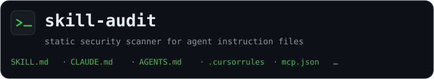
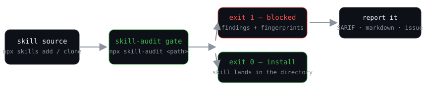

<p align="center"></p>

<p align="center">
  <a href="https://github.com/mkfeuhrer/skill-audit/actions/workflows/ci.yml"></a>
  <a href="https://www.npmjs.com/package/skill-audit"></a>
  <a href="https://www.npmjs.com/package/skill-audit"></a>
  <a href="LICENSE"></a>
  
</p>

**skill-audit** is a static security scanner for AI agent instruction files:
`SKILL.md`, `CLAUDE.md`, `AGENTS.md`, `.cursorrules`, `.cursor/rules/*.mdc`,
`.windsurfrules`, `.clinerules`, `.github/copilot-instructions.md` and MCP
server configs. It reads what a skill says *before your agent does* — which
hosts it talks to, which credentials it touches, what it hides in text a
reviewer never sees — and gates the install.

The agent-skills ecosystem is measured in millions of installs and has no
review layer. It needs one:

- Snyk's **ToxicSkills** research found prompt injection in **36%** of the
  skills it tested and catalogued **1,467** malicious payloads.
- The **Cloud Security Alliance** audited 3,984 skills: **36.8%** contained
  security flaws, **76** carried confirmed malicious payloads.
- **Mitiga** scanned 50,000+ instruction files across 7,000+ repos and found
  hijacked base URLs and **1,230+ files leaking API keys**.
- The [skills.sh](https://skills.sh) leaderboard shows typosquat copies of
  popular skills pulling **millions of installs**.

skill-audit is the missing gate: offline, deterministic, **zero runtime
dependencies** — the code you read here is byte-identical to the code that
runs, and `npx skill-audit` executes with nothing to install.

```console
$ npx skill-audit ~/.claude/skills
error   skills/alias-setup/SKILL.md:9:1   fs/wide-write
        Writes outside the project tree (shell config, SSH, or system paths).
error   skills/pinned-fetch/SKILL.md:11:1  exec/curl-pipe-sh
        Download piped directly into a shell interpreter.
warning skills/deploy-helper/SKILL.md:8:1  instr/consent-bypass
        Instructs the agent to act without user confirmation.
warning skills/driver-setup/SKILL.md:12:1  egress/undeclared-host
        Sends data to undeclared host "metrics.driver-cdn.com".

2 error(s), 2 warning(s), 0 note(s) across 4 file(s)
$ echo $?
1
```

## Governance: block and report

<p align="center"></p>

**Gate an install before the skill enters your agent's context:**

```shell
npx skill-audit ~/.claude/skills                 # audit everything installed
npx skill-audit ./skills --fail-on warning       # warnings block, not just errors
npx skill-audit .                                # audit this repo's agent files
```

Non-zero exit = do not install (or remove). `examples/install-gate.sh` wraps
the full clone → audit → install flow.

**Block regressions in CI** — this repo ships a GitHub Action
([`action.yml`](action.yml)) that runs the scan and uploads SARIF to code
scanning:

```yaml
jobs:
  skill-audit:
    runs-on: ubuntu-latest
    permissions:
      security-events: write
    steps:
      - uses: actions/checkout@v4
      - uses: mkfeuhrer/skill-audit@v1
        with:
          paths: .
          fail-on: warning
          version: 1.0.0   # pin for reproducible CI
```

Or inline, without the Action:

```yaml
- uses: actions/setup-node@v4
  with: { node-version: 22 }
- run: npx skill-audit . --format sarif --fail-on warning > skill-audit.sarif
- uses: github/codeql-action/upload-sarif@v3
  if: always()
  with: { sarif_file: skill-audit.sarif }
```

**Author-side: pre-commit hook** — [`pre-commit`](https://pre-commit.com)
users get the gate at commit time via [`.pre-commit-hooks.yaml`](.pre-commit-hooks.yaml):

```yaml
repos:
  - repo: https://github.com/mkfeuhrer/skill-audit
    rev: v1.0.0
    hooks:
      - id: skill-audit
```

**Report findings people can read** — `--format markdown` renders a
shareable table, `--format github` emits workflow annotations, every finding
carries a stable fingerprint for triage.

## What it finds

16 rules across egress, execution, filesystem, instruction-text, MCP-config
and permission hygiene — each documented with examples, remediation and
references in [`docs/rules/`](docs/rules/):

| Rule | Level | Catches |
|---|---|---|
| [`egress/undeclared-host`](docs/rules/egress-undeclared-host.md) | warning | Requests to hosts the skill never declared |
| [`egress/env-interpolated-url`](docs/rules/egress-env-interpolated-url.md) | error | URLs assembled from env/secret variables |
| [`exec/curl-pipe-sh`](docs/rules/exec-curl-pipe-sh.md) | error | `curl … \| sh` and friends |
| [`exec/shell-true`](docs/rules/exec-shell-true.md) | warning | `child_process`, `eval`, `shell: true`, permission-skip flags |
| [`exec/sudo-escalation`](docs/rules/exec-sudo-escalation.md) | warning | `sudo`/`doas` in skill code |
| [`exec/persistence`](docs/rules/exec-persistence.md) | error | crontab, launchctl, schtasks, systemd enable |
| [`fs/credential-read`](docs/rules/fs-credential-read.md) | error | Reads of `~/.ssh`, `~/.aws`, `.env`, `.npmrc`, keychain, `~/.kube` |
| [`fs/wide-write`](docs/rules/fs-wide-write.md) | error | Writes to shell config, `~/.ssh`, system paths |
| [`instr/hidden-unicode`](docs/rules/instr-hidden-unicode.md) | warning | Zero-width, bidi and tag characters |
| [`instr/html-comment-instruction`](docs/rules/instr-html-comment-instruction.md) | warning | Imperative text inside HTML comments |
| [`instr/override-language`](docs/rules/instr-override-language.md) | warning | "ignore previous instructions", persona hijacking |
| [`instr/self-modify`](docs/rules/instr-self-modify.md) | error | Skill installs or rewrites skills |
| [`instr/consent-bypass`](docs/rules/instr-consent-bypass.md) | warning | "act without asking the user", auto-yes pipes |
| [`mcp/unsafe-config`](docs/rules/mcp-unsafe-config.md) | error | Secret literals and plain-http endpoints in MCP configs |
| [`meta/obfuscated-blob`](docs/rules/meta-obfuscated-blob.md) | warning | Base64/hex blobs big enough to hide payloads |
| [`perm/overbroad`](docs/rules/perm-overbroad.md) | warning | `Bash`, `WebFetch`, `mcp__*` with no scope |

`skill-audit --list-rules` prints the same table from the binary you run.

## Formats

| `--format` | Use |
|---|---|
| `text` | terminal (default) |
| `json` | machines; includes a stable 40-char `fingerprint` per finding |
| `sarif` | GitHub code scanning |
| `markdown` | shareable report tables — issues, PRs, blog posts |
| `github` | `::error`/`::warning` workflow annotations |

## Config and suppression

`.skill-audit.json` in the working directory:

```json
{
  "allowedHosts": ["api.example.com"],
  "ignore": ["exec/shell-true"],
  "inlineAllows": false
}
```

Skills can declare their own hosts in frontmatter, which beats a global
allowlist:

```yaml
allowed-hosts: [api.example.com]
```

`.skill-audit-ignore` (read **only from the working directory**, never from
inside scanned paths — a skill cannot ship its own suppressions):

```
# suppress a rule everywhere
exec/shell-true

# suppress a rule for one file (path suffix)
fs/credential-read@skills/legacy/SKILL.md

# suppress one exact finding — copy the fingerprint from --format json
0d8f6c4bb4e55f3a1a09d6d3f2ee1a4427c8b905
```

Inline `skill-audit:allow` comments suppress the marked line and are
**opt-in** (`--inline-allows` or `"inlineAllows": true`) — the marker text
belongs to the skill author, so auditing untrusted skills keeps it off.

Exit codes: `0` clean, `1` findings at or above `--fail-on` (default
`error`), `2` usage error.

## Comparison

| | skill-audit | LLM-based scanners | sandbox scanners |
|---|---|---|---|
| Runs offline | yes | no | no |
| Deterministic | yes | no | mostly |
| Needs API keys | no | yes | no |
| Needs Docker | no | no | yes |
| CI-friendly (`<1s`, SARIF) | yes | rarely | heavy |
| Runtime deps | **0** | varies | varies |

Static text analysis is a floor, not a ceiling — see *Limits* below. It is
the part of a defense that can run on every install and every commit, which
is exactly where the ecosystem currently has nothing.

## What it found on real corpora

Captured against six corpora (2026-11-01, skill-audit 1.0.0); full reports in
[`examples/results/`](examples/results/):

| Corpus | Errors | Warnings | Headline |
|---|---|---|---|
| `anthropics/skills` (official) | 0 | 4 | consent-bypass phrasing in example skills |
| `obra/superpowers` | 4 | 3 | env-interpolated URLs in maintenance scripts |
| `addyosmani/agent-skills` | 5 | 14 | credential-store reads, shell surfaces |
| `magentosh/superpowers` (typosquat clone) | **366** | 7 | **357× `instr/self-modify`** — every generated skill embeds `npx skills add` |
| `bankai-skills/superpowers` (typosquat clone) | **366** | 7 | identical copy of the same generated content |
| 28 locally installed skills (`~/.claude/skills`) | 2 | 43 | a skill-manager running `npx skills add`, 30 shell surfaces |

The typosquat row is the whole pitch: the real `obra/superpowers` audits at
7 findings; its clones — installed millions of times via the public
leaderboard — audit at **373 each**, and they self-install. Findings are
questions, not verdicts; every rule page in
[`docs/rules/`](docs/rules/) explains the question it asks.

## Limits

- Static only. It reads text; it does not run, sandbox or trace a skill.
- Best-effort patterns. A determined author can evade every rule here, and
  a clean report is not a safety guarantee.
- Markdown code fences are scanned as code. Prose links are not flagged.
- POSIX paths only in v1.

## Security

Found something? Please use [GitHub's private vulnerability
reporting](https://github.com/mkfeuhrer/skill-audit/security/advisories/new)
on this repo. See [SECURITY.md](SECURITY.md) for scope and expectations.

## Development

```shell
npm test          # node --test, no install required beyond dev types
npm run typecheck # tsc --checkJs against jsconfig.json
```

The fixture corpus is the part worth forking: every rule has a malicious
fixture that must trip it and a benign one that must not, so tightening a
rule cannot silently regress it. Found a false positive in the wild? Add a
benign fixture, then fix the rule. See [CONTRIBUTING.md](CONTRIBUTING.md).

## License

[MIT](LICENSE)
